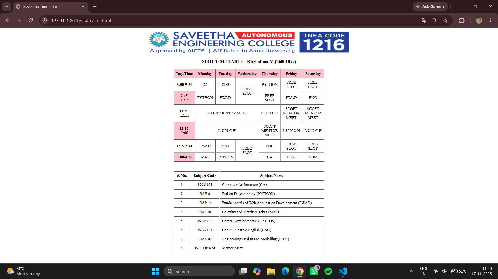

# Ex04 Time Table
## Date:17.11.2026

## AIM
To write a html webpage page to display your slot timetable.

## ALGORITHM
### STEP 1
Create a Django-admin Interface.

### STEP 2
Create an App inside the Django project.

### STEP 2
Create a static folder uder the created App and insert HTML code.

### STEP 3
Create a simple table using ```<table>``` tag in html with the relevant attributes.

### STEP 4
Add rows using ```<tr>``` tag.

### STEP 5
Add your course schedule using ```<td>``` tag.

### STEP 6
Execute the program using runserver command.

## PROGRAM
```
<html>
    <head>
        <title>Saveetha Timetable</title>
    </head>

<body>

<center>
    
    <h3>SLOT TIME TABLE - Rivyudhaa M (26001079)</h3>
    <table border="3" cellpadding="8" cellspacing="1"
       width="620" bgcolor="">
       <tr bgcolor="pink">
        <th>Day/Time</th>
        <th>Monday</th>
        <th>Tuesday</th>
        <th>Wednesday</th>
        <th>Thursday</th>
        <th>Friday</th>
        <th>Saturday</th>
       </tr>
       <tr>
        <th bgcolor="white">8:00-9:30</th>
        <td align="center">CA</td>
        <td align="center">CDS</td>
        <td rowspan="2" align="center">FREE SLOT</td>
        <td align="center">PYTHON</td>
        <td align="center">FREE SLOT</td>
        <td align="center">FREE SLOT</td>
       </tr>
       <tr>
        <th bgcolor="pink">9:45-11:15</th>
        <td align="center">PYTHON</td>
        <td align="center">FWAD</td>
        <td align="center">FREE SLOT</td>
        <td align="center">FWAD</td>
        <td align="center">ENG</td>
       </tr>
       <tr>
        <th bgcolor="white">11:30-12:15</th>
        <td colspan="3" align="center">SCOFT MENTOR MEET</td>
        <td align="center">L U N C H</td>
        <td align="center">SCOFT MENTOR MEET</td>
        <td align="center">SCOFT MENTOR MEET</td>
       </tr>
       <tr>
        <th bgcolor="pink">12:15-1:00</th>
        <td colspan="3" align="center">L U N C H</td>
        <td align="center">SCOFT MENTOR MEET</td>
        <td colspan="center" align="center">L U N C H</td>
        <td colspan="center" align="center">L U N C H</td>
       </tr>
       <tr>
        <th bgcolor="white">1:15-2:44</th>
        <td align="center">FWAD</td>
        <td align="center">MAT</td>
        <td rowspan="2" align="center">FREE SLOT</td>
        <td align="center">ENG</td>
        <td align="center">FREE SLOT</td>
        <td align="center">FREE SLOT</td>
       </tr>
       <tr>
        <th bgcolor="pink">3:00-4:30</th>
        <td align="center">MAT</td>
        <td align="center">PYTHON</td>
        <td align="center">CA</td>
        <td align="center">EDM</td>
        <td align="center">EDM</td>
       </tr>
    </table>

    <br><br>

    <table border="1" cellpadding="8" width="620">
        <tr>
            <th>S. No.</th>
            <th>Subject Code</th>
            <th>Subject Name</th>
        </tr>

        <tr>
            <td align="center">1.</td>
            <td align="center">19CS305</td>
            <td>Computer Architecture (CA)</td>
        </tr>
        <tr>
            <td align="center">2.</td>
            <td align="center">19AI301</td>
            <td>Python Programming (PYTHON)</td>
        </tr>
        <tr>
            <td align="center">3.</td>
            <td align="center">19AI414</td>
            <td>Fundamentals of Web Application Development (FWAD)</td>
        </tr>
        <tr>
            <td align="center">4.</td>
            <td align="center">19MA201</td>
            <td>Calculus and Matrix Algebra (MAT)</td>
        </tr>
        <tr>
            <td align="center">5.</td>
            <td align="center">19EY708</td>
            <td>Career Development Skills (CDS)</td>
        </tr>
        <tr>
            <td align="center">6.</td>
            <td align="center">19EN101</td>
            <td>Communicative English (ENG)</td>
        </tr>
        <tr>
            <td align="center">7.</td>
            <td align="center">19AI302</td>
            <td>Engineering Design and Modelling (EDM)</td>
        </tr>
        <tr>
            <td align="center">8.</td>
            <td align="center">E-SCOFT-M</td>
            <td>Mentor Meet</td>
        </tr>
    </table>
</center>
</body>
</html>

```

## OUTPUT


## RESULT
The program for creating slot timetable using basic HTML tags is executed successfully.
